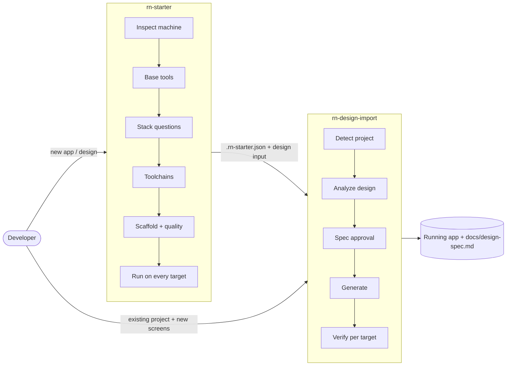
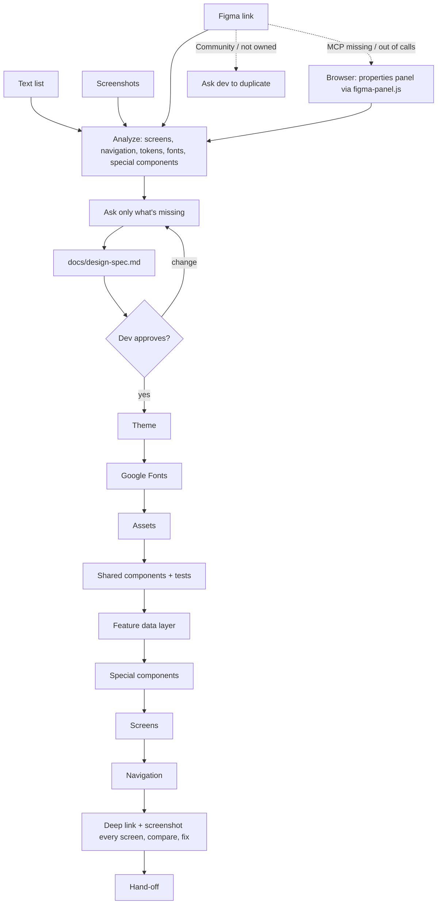
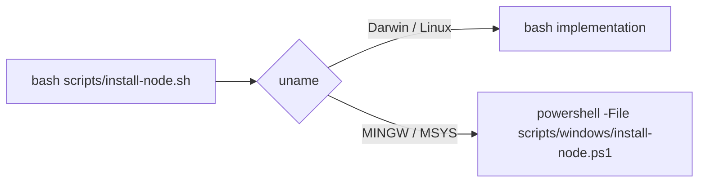

# rn-starter — Design

How the plugin is built and why. What it must do is in [spec.md](spec.md); day-to-day working notes for agents are in [CLAUDE.md](CLAUDE.md).

## Principles

1. **The model decides, scripts do.** Judgment (which stack fits, how a design maps to screens) stays with Claude. Anything deterministic — detecting tools, installing them, booting emulators, checking libraries — is a script with stable output, so it behaves the same on every machine and every run.
2. **Clear blockers, stop only for humans.** Missing tools are installed after one question. The wizard stops only for what a person must do (admin password, Apple ID, reboot, license, file access), prints the exact steps, and keeps working on everything that doesn't depend on it.
3. **Never offer what can't work.** Options are filtered by a compatibility matrix and by earlier answers; questions that depend on an answer are asked in a later round.
4. **Verify by looking.** Success means a screenshot of the running app on each selected target, not a build log.
5. **Live facts over frozen lists.** Versions, Expo SDK pins, New Architecture support and maintenance status are looked up at run time (`lib-info.sh`, nodejs.org, Google's SDK manifest), because they change faster than any document.
6. **Follow the project.** Existing conventions win; defaults apply only where the project hasn't decided.

## Repository layout

```
.claude-plugin/
  plugin.json            manifest (name, version — bump on every push)
  marketplace.json       lets `claude plugin marketplace add <repo>` install it
skills/
  rn-starter/
    SKILL.md             the wizard: phases 0–8, question rounds, rules
    scripts/             bash entry points (+ windows/*.ps1 twins)
    assets/claude/       CLAUDE.md template, format hook, code-reviewer agent for generated projects
    references/          loaded on demand: compatibility, frameworks, libraries,
                         structure, quality, troubleshooting
  rn-design-import/
    SKILL.md             design → UI: phases 0–6
    scripts/             detect-project, palette, google-font, ttf-name,
                         figma-panel.js, lib-info, svg-icons
    references/          input-text/image/figma, spec-template, theme, fonts,
                         navigation, special-components, conventions, verify,
                         follow-up
```

Each `SKILL.md` stays short (~200 lines) and points to references for detail, so only what the current phase needs is loaded into context.

## Architecture



The two skills are independent: `rn-starter` can finish with an empty app, and `rn-design-import` works on any RN/Expo project. They connect through two files:

| Contract | Written by | Read by | Content |
|---|---|---|---|
| `.rn-starter.json` | rn-starter (Phase 6) | rn-design-import, future skills | framework, template, package manager, bundler, navigation, state, server data, styling, lint, run targets, quality rules, design input |
| `docs/design-spec.md` | rn-design-import (Phase 3) | the developer (approval), later imports | screens + routes + status, navigation tree, tokens, fonts, special components, shared components, assets, open points |

`detect-project.sh` merges `.rn-starter.json` with what `package.json` and the file tree actually say, and reports mismatches, so a project not created by `rn-starter` (or edited since) is still understood.

## rn-starter flow

| Phase | Does | Scripts | Stops for a human when |
|---|---|---|---|
| 0 Inspect | tool inventory, OS, arch | `doctor.sh [--android --ios --cocoapods]` | — |
| 1 Base tools | git, Node LTS, package manager | `install-node.sh` | git on macOS needs the Command Line Tools dialog |
| 2 Stack | framework → run targets → bundler/template → name → design input | — | answers |
| 3 Libraries | navigation, state, data, styling, lint, structure, code quality, hook rules | — | answers |
| 4 Toolchains | Android: JDK + SDK + AVD; iOS: Xcode checks, runtime, simulator, CocoaPods | `install-android.sh`, `setup-ios.sh` | SDK license; Xcode download, `sudo` steps; Windows hypervisor (admin + reboot) |
| 5 Confirm | summary of every choice | — | approval |
| 6 Scaffold | create, structure, `.rn-starter.json`, quality tooling, Claude Code files, first commit | `setup-quality.sh`, `setup-claude.sh` | — |
| 7 Run | every selected target, checklist | `start-simulator.sh`, `start-emulator.sh` | phone via Expo Go (dev confirms) |
| 7b Design | hand over to rn-design-import | — | — |
| 8 Hand-off | README sections, summary | — | — |

### Question design

- `AskUserQuestion`, ≤ 4 questions per call, the recommended option first. A developer who always accepts the recommendation gets a working app.
- **Dependent questions go in a later call.** All questions in one call are shown at once, so run targets can't be filtered by a framework answer given in the same call. (Found in testing: RN CLI was offered Expo Go.)
- **"Other" is a requirement, not noise:** turned into concrete config, shown to the developer before applying, checked against the compatibility matrix, verified like a built-in option, recorded. Worked examples: Jira-key commit messages, branch-name rules.
- The developer's language is used for questions; repository content stays in English.

## rn-design-import flow



Input handling:

| Input | Exact values from | Approximate |
|---|---|---|
| Text | — | everything; defaults from `input-text.md` (screen-name → role/content table) |
| Screenshot | colors via `palette.py` (pixel sampling) | sizes (from @2x/@3x scale), font family (confirmed by the dev) |
| Figma MCP | variables, styles, layout, assets | — (frugal call plan: metadata once, variables once, one context call per screen) |
| Figma in browser | hex colors, font family/style/size, line height, letter spacing, size, radius from the properties panel | layout from screenshots |

## Generated project architecture

Defined in `skills/rn-starter/references/structure.md` and followed by both skills:

```
src/app/                      routes only — one-line re-exports
src/screens/<name>/           index.tsx (the screen), components/, hooks.ts, types.ts, utils.ts, __tests__/
src/components/ hooks/ services/ mocks/ stores/ types/ constants/ theme/ lib/ utils/   shared; never import screens
```

Layered, kebab-case files, arrow-function components with named exports, tests in `__tests__/`. Enforced with ESLint `no-restricted-imports`: UI files (`.tsx`) can't import `@/services` or `@/mocks` (data comes through hooks), only `services/` and tests import mocks, shared folders can't import screens. Special-component libraries are wrapped in a component so screens never depend on a library directly. Projects from 1.x on the feature-first layout keep it (`detect-project.sh` reports `structure`).

With the Claude Code option, the project also gets `CLAUDE.md` (stack, commands, these rules), a `PostToolUse` hook that runs the project's Prettier/ESLint (or Biome) on every file Claude edits and returns leftover errors to Claude, and a read-only `code-reviewer` subagent. All three are generated by `setup-claude.sh` from `skills/rn-starter/assets/claude/`.

## Script conventions

| Convention | Why |
|---|---|
| `doctor` output: `ok|warn|missing <name> <detail>` lines + `summary missing=… warn=…` | Claude parses one format on every OS |
| Exit codes: `0` done · `1` error · `2` waiting on the developer (prints `ACTION REQUIRED` + exact commands) · `3` done with a warning that needs a decision (`setup-quality.sh`: type-check hook on a project failing `tsc`) | the skill knows whether to retry, ask or relay |
| Idempotent: rerunning fills gaps only | after a human step the skill just reruns the same command |
| Shell rc edits inside marked blocks `# >>> rn-starter:<name> >>>` | no duplicates on rerun; removable |
| `env.sh` (and `windows/env.ps1`) put freshly installed tools on PATH | Claude's shell doesn't reload rc files between calls |
| No interactive prompts, no hidden output on long installs | a silent install looks exactly like a hang (found in testing) |
| Read-only scripts never change anything | safe to run any time |

## Cross-platform strategy



- On Windows, Claude Code runs commands in Git Bash, so the skill uses the same commands everywhere. Each `.sh` entry point calls `delegate_to_windows <name>.ps1 "$@"` right after loading `lib.sh`.
- PowerShell twins target **Windows PowerShell 5.1** (what a clean Windows has): no 7-only syntax, native calls through `Invoke-Native` so stderr lines don't become terminating errors, TLS 1.2 forced, progress bars off.
- Installs are per user: `%LOCALAPPDATA%\rn-starter\{node,jdk-17}`, `%LOCALAPPDATA%\Android\Sdk`, user-level `PATH`/`JAVA_HOME`/`ANDROID_HOME`. macOS/Linux: `~/.local/share/{fnm,rn-starter}`, `~/Library/Android/sdk` / `~/Android/Sdk`.
- Run targets are filtered by OS: no iOS Simulator on Windows/Linux.

## Key decisions

| Decision | Why | Alternatives considered |
|---|---|---|
| Expo default, RN CLI advanced; Rock excluded | Expo runs on a phone with no toolchain; Rock deferred by the owner | CLI default |
| Node via fnm (macOS/Linux), official zip (Windows) | no Homebrew, sudo or admin on a clean machine | Homebrew, nvm, MSI installer |
| pnpm: `nodeLinker: hoisted` + `strictDepBuilds: false` in `pnpm-workspace.yaml` | Metro/autolinking need a flat `node_modules`; pnpm 11+ fails installs on skipped build scripts; `.npmrc` makes npm warn on every `npx` | `.npmrc`, `allowBuilds` lists (break with each new dependency) |
| Warn on pnpm 11 | it keeps registry sockets open and never exits after "Done" | — |
| CocoaPods via Homebrew | macOS system Ruby 2.6 can't install current CocoaPods deps | bundler + system Ruby, rbenv |
| JDK 17 Temurin + command-line tools, no Android Studio | smaller, scriptable, no GUI installer | Android Studio |
| Pin `ANDROID_USER_HOME` | avdmanager (Java) and the emulator resolve home differently → AVD "missing" | — |
| Commit the scaffold before installing hooks | templates ship lint errors that would block the first commit | hooks first |
| Never keep a failing type-check hook (exit 3) | it blocks every push from day one | silently enabling it |
| TS 6: `jest-env.d.ts` with `/// <reference types="jest" />` | TypeScript 6 no longer auto-loads `@types/*` | tsconfig `types` (narrows other types) |
| RNTL 14 async APIs in all generated tests | `render` and user events are async in v14 | `fireEvent` |
| Layered structure (`screens/ components/ hooks/ services/`) with ESLint rules on UI files | matches Expo's guidance, Ignite and the team's own apps; the first layered version failed because screens imported mocks, so `.tsx` files now can't import `services/` or `mocks/` | feature-first `features/<domain>/` (1.x; the team found it unlike their projects) |
| Theme setup follows the styling choice; tokens are plain data; a UI library's theme is the only theme | one token file feeds StyleSheet, Unistyles, NativeWind or the library; two theme systems drift | per-instance `makeStyles` (one copy per list row); Ignite's `themed()` (rebuilt every render); a theme context |
| Plain StyleSheet: static styles in `StyleSheet.create`, colors via `createThemedStyles` cached per scheme | `StyleSheet.create` is an identity function (no speed-up); Expo's guide picks per-scheme static styles; caching per scheme keeps that with one helper — verified: 1000 rows share one object, built twice per app lifetime | `makeStyles`, inline colors everywhere |
| Wizard offers only React Native Paper as a UI library | the only one that installed, type-checked and bundled cleanly on Expo SDK 58 (Oct 2026); gluestack-ui's CLI broke the `@/` alias and pulled alpha/RC versions, Tamagui 3 failed tsc and static evaluation | gluestack-ui, Tamagui, Reusables (details in `libraries.md`) |
| The design decides the scheme: a one-scheme design locks the app to it (`userInterfaceStyle: "light"`) | following the system with `dark = light` gave white status-bar text on white backgrounds and stock dark headers on phones in dark mode | always `automatic` |
| Light/dark override via `Appearance.setColorScheme` | `useColorScheme()` and native Alerts/pickers follow it with no extra context | a custom theme context |
| Icons: SVG from the design → components in `src/components/icons/` via `svg-icons.sh` (SVGR), standard glyphs included | PNG @3x icons can't be tinted or scaled cleanly, and icon-font look-alikes (Ionicons for Iconly) drifted from the design in the first coffee-shop run | PNG in `assets/icons`, `@expo/vector-icons` for standard glyphs |
| Format hook in Node, not shell + jq | runs unchanged on Windows; jq isn't on a clean machine | bash hook |
| Figma browser fallback reading the properties panel | Starter/free plans allow ~6 MCP calls/month; the panel is HTML with exact values | exported PNGs only |
| Live `lib-info.sh` checks | a static list recommended an unmaintained geolocation library | curated table only |
| Two skills instead of one | design import is reused daily on existing apps; keeps the wizard small | one big skill |
| Later designs map colors onto existing tokens (channels within 3 = same token; same role but visibly different = ask) | a feature design repeated the theme's colors one step off; taking them literally adds near-duplicate tokens | a new token per hex |
| Shared mutable mock state = module variable in the service + mutation updating the query cache | favorites written on Detail must show at once on another tab; services stay the only thing the API swap touches | screen `useState`, a store for mock data |
| Per-screen `StatusBar` inside tabs renders only while focused | mounted hidden tabs override the visible tab's style (found in the Bag tab of the first coffee-shop import) | one global style |

## Verification

**Inside a run** (what the skill itself does): `tsc` against a baseline taken in Phase 0, ESLint with boundary rules, unit tests, `expo-doctor`, `expo export` bundle check, hooks exercised without creating commits, then deep links + screenshots on each target and a tapped main flow.

**Of the skill** (how it was tested during development):
- Clean-machine simulation: `env -i HOME=<empty dir> PATH=/usr/bin:/bin bash <script>` — installs Node, Android SDK, creates AVDs from nothing (found the AVD-location bug).
- End-to-end on macOS: Expo and RN CLI apps on the iOS Simulator and Android emulator, screenshots read back.
- A subagent ran `rn-design-import` from a text description and reported every instruction that was wrong or ambiguous (14 findings, all fixed).
- Windows: PowerShell parsed with pwsh, helper logic and live download selection exercised, Git Bash delegation simulated with stub `uname`/`cygpath`/`powershell.exe`; then run end to end on a clean Windows machine (environment install → Expo app built from a Figma design).

## Limitations and risks

- On Windows only the Expo + Android emulator + Figma path has run on real hardware; RN CLI and quality tooling there are still untested.
- Tool versions drift (Expo SDK, RN, Xcode, pnpm). `compatibility.md` records what was verified; `lib-info.sh` covers libraries, not the toolchain.
- Figma browser reading depends on Figma's UI; layout changes can break `figma-panel.js` selectors.
- Screenshot input can't reveal font names, hidden states or scrolled-off content — written to Open points.
- Physical iPhones only through Expo Go; native builds on devices (signing) are out of scope.
- `palette.py`/`ttf-name.py` need Python, absent on a clean Windows.

## Extending

| To add… | Change |
|---|---|
| A library option | `rn-starter/references/libraries.md` (+ compatibility notes); for design-driven components `rn-design-import/references/special-components.md` |
| A run target or OS | `compatibility.md` matrix, Phase 2 filtering in `SKILL.md`, a script (+ PowerShell twin) |
| A question | `SKILL.md` round where its dependencies are already answered; recommended default; `.rn-starter.json` field |
| A new skill (e.g. API connection) | read `.rn-starter.json` and the layout; write only into `src/services/` (and `src/hooks/` when a hook's shape changes) |
