# rn-starter

A Claude Code plugin that takes a React Native / Expo app from an empty machine to verified features and approved production releases. Seven skills: describe what you want in your own words, or type the skill's name. Each skill asks only what it needs, stops where a person approves, and says plainly what it checked and what it didn't.

**Guide with a skill map:** [rn-starter Playbook](https://claude.ai/artifact/CQMGK2v5CvvagkQQBUWEEk)

## Skills

| Skill | Use it for | Try |
|---|---|---|
| `rn-starter` | A fresh machine (macOS, Windows, Linux) to a running app: toolchain, Expo or RN CLI, libraries, layered structure, tests, git hooks, Claude Code guard rails | *"Create a new React Native app called coffee-shop"* |
| `rn-feature` | A ticket (Jira / Asana / Trello / GitHub link, pasted text, or your own words): numbered requirements, gaps as questions for PO / design / backend, then a step-by-step build with every requirement proven in the app | `/rn-feature SHOP-12` |
| `rn-ui` | Themed, navigable screens from a description, screenshots or Figma, checked against the design on the simulator | *"Build the screens from this Figma: …"* |
| `rn-api-connect` | Mocks to the real backend from its Swagger / OpenAPI spec: generated types, a typed client, one domain at a time, loading / error / empty states | *"Connect the app to the API, Swagger is here: …"* |
| `rn-e2e` | One Maestro flow per requirement, run on the simulator against mocks, ready for CI | *"Write E2E tests for the cart flow"* |
| `rn-release-setup` | Two store apps from one codebase (a dev app and the production app), EAS and every credential for TestFlight and Google Play, from the files you or the client provide, plus the release gate | *"Set up EAS so we can ship to TestFlight"* |
| `rn-release` | Release day: release notes and CHANGELOG, version, store build or OTA update, checklist, a release PR / MR that a release manager merges into the production branch, then the merged commit ships and the version is locked | `/rn-release` |

<a href="https://claude.ai/artifact/CQMGK2v5CvvagkQQBUWEEk"></a>

Click the map for the interactive version in the [guide](https://claude.ai/artifact/CQMGK2v5CvvagkQQBUWEEk), with every step inside each skill.

Text after a slash command is read as your request (`/rn-feature add a share button on Detail`). With nothing after it, the skill asks what it's missing.

## Prerequisites

- **Computer:** macOS, Windows or Linux. The iOS Simulator needs macOS with Xcode installed from the App Store (a free Apple ID is enough); `rn-starter` installs everything else (Node, JDK, Android SDK and emulator, CocoaPods).
- **Claude Code**, signed in. Optional: the Figma MCP or Claude in Chrome for designs, the GitHub or GitLab CLI (`gh`, `glab`) to open PRs / MRs for you.
- **For releases:** a free Expo account (EAS), and from you or the client an Apple Developer account and a Google Play Console account (`rn-release-setup` lists exactly which files it needs).

## Install

```bash
curl -fsSL https://claude.ai/install.sh | bash        # Claude Code, if you don't have it
claude plugin marketplace add canhvo-agilityio/rn-starter-skills
claude plugin install rn-starter@rn-starter-skills
```

Restart Claude Code and start it in the project folder (or its parent for a new app). To update, reinstall (the version number may not change between pushes):

```bash
claude plugin marketplace update rn-starter-skills
claude plugin uninstall rn-starter@rn-starter-skills
claude plugin install rn-starter@rn-starter-skills
```

A project created with an older version gets the new hooks and subagents with `setup-claude.sh --update-agents`.

## Ground rules

- Never reads `.env` or credential files; it asks you for the values it needs.
- Stops for a person at the design spec, the ticket's answers, the plan and the push. Pushes to protected branches are blocked.
- The production app ships only from a commit a release manager merged into the protected production branch (the release PR / MR); the release gate checks it with git and blocks EAS builds, submits, OTA updates and release tags otherwise. Works on GitHub and GitLab.
- Nothing is reported done without evidence; what wasn't checked is listed as not verified.
- You do what needs your password or account: installing Xcode, `sudo` commands, signing in to Expo, the board or Figma.

## Stack

Verified 2026-10: Expo SDK 58, React Native 0.88, Node 24 LTS, JDK 17, Android API 35, Xcode 26.6 / iOS 26.5. App defaults: TypeScript, expo-router, Zustand, TanStack Query, NativeWind, ESLint + Prettier, Jest + React Native Testing Library, Maestro, EAS (a dev app and a production app). Details and alternatives: [`compatibility.md`](skills/rn-starter/references/compatibility.md), [`libraries.md`](skills/rn-starter/references/libraries.md).

`rn-starter` is tested end to end on the iOS Simulator and the Android emulator. The ticket loop (`rn-ui`, `rn-feature`, `rn-e2e`) has run on a real project on the iOS Simulator with Expo Go; on Android, real devices and CI it isn't verified yet. The release gate is covered by tests (`node --test skills/rn-starter/assets/claude/release-gate.test.mjs`); `rn-release` against a real EAS project and the store submits aren't verified yet.

## Layout

```
.claude-plugin/          plugin.json, marketplace.json
skills/<skill>/
  SKILL.md               the skill's flow
  scripts/               helpers the skill runs (print JSON; exit 2 = waiting on you, 3 = a decision needed)
  references/            details the skill reads when it needs them
skills/rn-starter/assets/claude/   CLAUDE.md template, guard, release-gate (with its test) and format hooks, code-reviewer and verifier subagents
```

Quick machine check: `bash skills/rn-starter/scripts/doctor.sh --android --ios --cocoapods`. When upgrading versions, update `compatibility.md` first, then rerun `rn-starter` on a clean machine.
